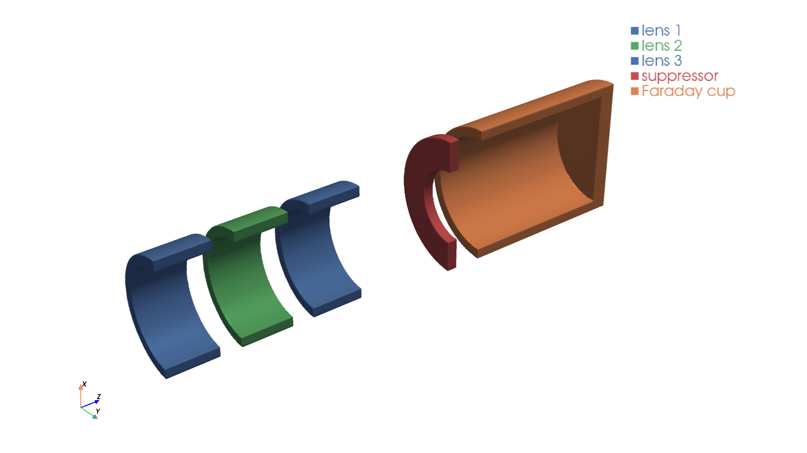
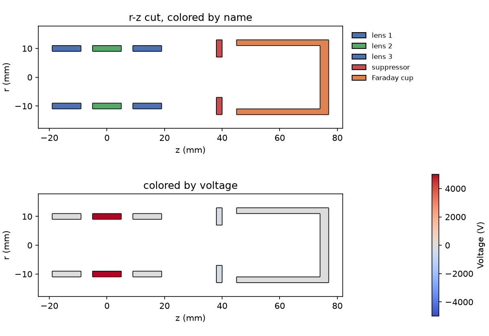
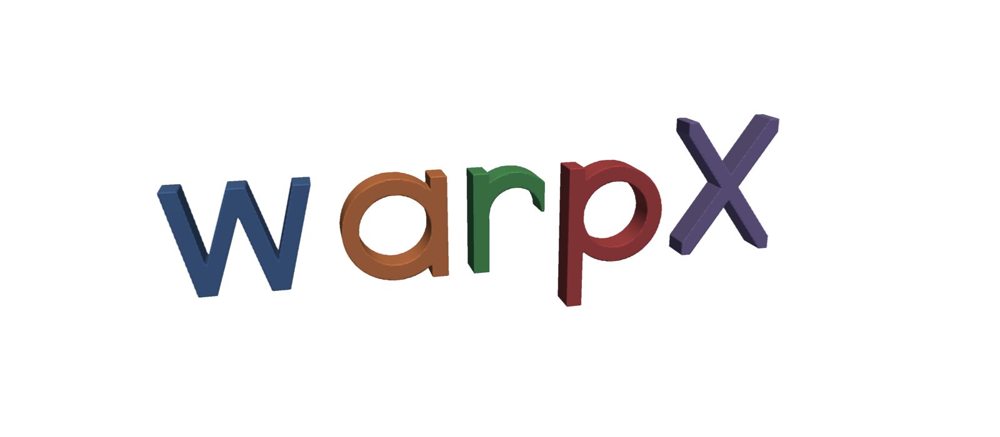

# WarpX Geometry

[](https://github.com/BLAST-WarpX/warpx-geometry/actions/workflows/tests.yml)
[](https://spdx.org/licenses/BSD-3-Clause-LBNL.html)

Simple geometry objects for [WarpX](https://warpx.readthedocs.io/) embedded boundaries.

This package provides an easy way to define simple and complex 3D geometries as analytical functions for WarpX particle-in-cell simulations. It supports both Cartesian (XYZ) and cylindrical (RZ) coordinate systems.

## Gallery

An einzel lens followed by a suppressor ring and a Faraday cup, built in RZ and
shown as a 3D cutaway and as r-z cuts colored by name and by voltage
([`examples/einzel_lens_faraday_cup.py`](examples/einzel_lens_faraday_cup.py)):





"warpX" built from boxes, rotated boxes and hollow cylinders, one named
conductor per letter
([`examples/warpx_letters.py`](examples/warpx_letters.py)):



Every picture shows exactly the expression that is handed to WarpX.

## Features

- **Simple geometric primitives**: Cylinders, boxes, cones, tori
- **Boolean operations**: Union, difference, intersection
- **Transformations**: Translation, scaling, rotation
- **Named conductors**: Assign voltages and colors by name
- **Complex shapes**: Rounded cylinders with fillets, hollow cylinders
- **Pre-built components**: Einzellens and other common structures
- **RZ geometry support**: Optimized for cylindrical simulations
- **Visualization**: Smooth 2D cuts (matplotlib) and 3D views (pyvista) of exactly
  what WarpX sees, colored by name or voltage — for quick checks and publication figures

## Installation

Requires Python 3.11 or newer. The optional `viz` extra installs
[pyvista](https://pyvista.org) for 3D plotting (`pip install -e ".[viz]"`);
VTK does not provide wheels for Python 3.15 yet, so on 3.15 only the 2D plots
are available.

### Using uv (recommended)

[uv](https://github.com/astral-sh/uv) is a fast Python package manager that handles virtual environments and dependencies:

```bash
# Install from source
git clone https://github.com/BLAST-WarpX/warpx-geometry.git
cd warpx-geometry
uv pip install -e .
```

### Using pip

```bash
# Install from source
git clone https://github.com/BLAST-WarpX/warpx-geometry.git
cd warpx-geometry
pip install -e .
```

### Development installation

For development with testing and linting tools:

```bash
# Using uv
uv pip install -e ".[dev]"

# Using pip
pip install -e ".[dev]"
```

## Quick Start

### Basic Cylinder in XYZ Coordinates

```python
from warpx_geometry import Cylinder, CylinderZ, Geometry

# Create a finite cylinder along the z-axis
# Radius: 10mm, extending from z=0 to z=100mm
cyl = CylinderZ(radius=0.010, zmin=0.0, zmax=0.1)

# Wrap it in Geometry to get WarpX-compatible output
geom = Geometry(cyl)

# Use in WarpX input: the string representation is the analytical function
print(str(geom))  # WarpX embedded boundary function
```

### Boolean Operations

```python
from warpx_geometry import CylinderZ, Box, Union, Diff, Geometry

# Create a hollow cylinder (difference of two cylinders)
outer = CylinderZ(radius=0.011, zmin=0.0, zmax=0.1)
inner = CylinderZ(radius=0.010, zmin=-0.01, zmax=0.11)
hollow = outer - inner  # Using - operator for difference

# Or use pre-built hollow cylinder
from warpx_geometry import CylinderZ_hollow

hollow = CylinderZ_hollow(radius_outer=0.011, radius_inner=0.010, zmin=0.0, zmax=0.1)

# Combine multiple objects
electrode1 = CylinderZ(radius=0.01, zmin=0.0, zmax=0.02)
electrode2 = CylinderZ(radius=0.01, zmin=0.05, zmax=0.07)
combined = electrode1 + electrode2  # Union using + operator

geom = Geometry(combined)
```

### RZ (Cylindrical) Geometry

For RZ simulations, geometries are evaluated in the r-z plane (at y=0, with x representing the radial coordinate r):

```python
from warpx_geometry import CylinderZ, Einzellens, Geometry
import numpy as np

# Create a simple electrode
electrode = CylinderZ_hollow(
    radius_outer=0.015, radius_inner=0.012, zmin=0.0, zmax=0.05
)

# Or use a pre-built Einzellens (3-electrode focusing lens)
lens = Einzellens(
    radius=0.015,  # Mean radius
    thickness=0.002,  # Wall thickness
    length=0.02,  # Length of each electrode
    gap=0.01,  # Gap between electrodes
)

geom = Geometry(lens)

# Evaluate on RZ grid for visualization
z = np.linspace(0.0, 0.15, 100)
r = np.linspace(0.0, 0.02, 50)
Z, R = np.meshgrid(z, r, indexing="ij")

# In RZ: x represents r, y=0
X = R
Y = np.zeros_like(R)

mask = geom.eval(X, Y, Z)
```

### Advanced Shapes

```python
from warpx_geometry import RoundedCylinderZ, Cone, Torus, Geometry

# Cylinder with rounded (filleted) edges
rounded = RoundedCylinderZ(
    radius=0.010,
    zmin=0.0,
    zmax=0.05,
    fillet_radius=0.001,
    fillet_top=True,
    fillet_bottom=True,
)

# Cone (tapered cylinder)
cone = Cone(
    z1=0.0,
    z2=0.1,  # Axial extent
    r1=0.010,
    r2=0.005,  # Radii at z1 and z2
)

# Torus (useful for fillets and rounded edges)
torus = Torus(
    major_radius=0.010,  # Distance from z-axis to tube center
    minor_radius=0.001,  # Tube radius
    z_center=0.1,  # Z-position
)

geom = Geometry(rounded + cone)
```

### Translation

```python
from warpx_geometry import CylinderZ, Translate, Geometry

# Create a cylinder
cyl = CylinderZ(radius=0.01, zmin=0.0, zmax=0.05)

# Translate it
cyl_translated = Translate(cyl, x=0.02, y=0.0, z=0.1)

geom = Geometry(cyl_translated)
```

### Visualization

`plot_2d` (matplotlib) and `plot_3d` (pyvista) evaluate the WarpX expression on a
grid and contour it at zero, so outlines and surfaces are smooth. They accept a
geometry object, a `Geometry` (RZ geometries are revolved in 3D) or a dict
`{label: object}`. Named conductors are drawn as separate components; color them
with a `{name: color}` dict or by voltage with `color_by="voltage"`.

```python
import matplotlib.pyplot as plt
from warpx_geometry import CylinderZ, CylinderZ_hollow, Geometry
from warpx_geometry.viz import plot_2d, plot_3d

lens = CylinderZ_hollow(0.011, 0.009, -0.005, 0.005, name="lens", default_voltage=5000)
cup = CylinderZ_hollow(0.013, 0.011, 0.02, 0.05) + CylinderZ(0.013, 0.049, 0.052)
geo = Geometry(lens + cup.named("cup"), rz=True)

# 2D: r-z cut (default for RZ), also "xz", "yz", "xy" with position=...
ax = plot_2d(geo, mirror=True, colors={"lens": "tab:blue", "cup": "tab:orange"})
plot_2d(geo, color_by="voltage")  # colorbar from the conductor voltages
plt.savefig("geometry.pdf")  # vector output for publications

# 3D: clip="y" cuts away the +y half to look inside
plot_3d(geo, clip="y")  # interactive window
plot_3d(geo, clip="y", resolution=400, screenshot="geometry.png")  # high quality
```

Useful options: `resolution` (grid points along the longest axis; ~100 for quick
checks, 300+ for figures), `bounds`/`extent` (needed for unbounded shapes such as
`Cylinder`), `units` (`"mm"` by default), `camera_position`/`view`/`zoom`, and
`plotter=` to add to an existing pyvista scene. `geometry_meshes` returns the
surface meshes for custom rendering or export (e.g. STL).

### RZ Geometry Plotting

```python
from warpx_geometry import CylinderZ_hollow, plot_rz_geometry_components
import matplotlib.pyplot as plt

# Create geometry components
vacuum_tube = CylinderZ_hollow(0.020, 0.018, 0.0, 0.2)
electrode = CylinderZ_hollow(0.016, 0.014, 0.08, 0.12)

# Set up plot
fig, ax = plt.subplots(figsize=(10, 6))

# Plot multiple components with different colors
components = {
    "tube": (vacuum_tube, "lightgray"),
    "electrode": (electrode, "red"),
}

plot_rz_geometry_components(
    ax,
    components,
    z_range=(0.0, 0.2),  # meters
    r_range=(0.0, 0.025),  # meters
    resolution_factor=10,  # Higher = smoother edges
)

ax.set_xlabel("z (mm)")
ax.set_ylabel("r (mm)")
ax.set_title("RZ Geometry")
plt.show()
```

## Using with WarpX

The `Geometry` wrapper produces WarpX-compatible embedded boundary functions:

```python
from warpx_geometry import CylinderZ_hollow, Geometry

# Define your geometry
electrode = CylinderZ_hollow(
    radius_outer=0.015, radius_inner=0.012, zmin=0.0, zmax=0.05
)

geom = Geometry(electrode)

# In your WarpX Python input script:
# The string representation is the analytical function WarpX needs
geometry_function = str(geom)

# Use with WarpX embedded boundary
# (example for WarpX input file or Python script)
# warpx.embedded_boundary.function = geometry_function
```

### WarpX Embedded Boundary Convention

WarpX uses the following convention for embedded boundaries:
- Function returns **> 0** inside the conductor
- Function returns **< 0** outside the conductor

Every shape produces a smooth function that follows this convention and is
zero exactly on its surface (where practical, the signed distance to the
surface, e.g. `0.01-sqrt(x**2 + y**2)` for a cylinder of radius 10 mm).
Shapes are combined with `min`/`max`, which keeps the zero crossing on the
combined surface:

| Operation | Expression |
|---|---|
| `a + b` (union) | `max(fa, fb)` |
| `Intersection(a, b)` | `min(fa, fb)` |
| `a - b` (difference) | `min(fa, -fb)` |

The smooth function lets AMReX locate the cut cells efficiently. `eval()`
still returns 0/1 (outside/inside) for plotting.

## Voltage Assignment (Named Conductors)

Each shape can be given a `name` and optional `default_voltage`.  
A `Geometry` object collects all named shapes into a `conductors` dict and can generate
a WarpX-compatible potential expression via `to_potential_expr`.

```python
from warpx_geometry import CylinderZ_hollow, Geometry, Union

# Build a multi-electrode system — give each conductor a name
ring_0 = CylinderZ_hollow(
    radius_outer=0.067,
    radius_inner=0.051,
    zmin=-0.001,
    zmax=0.001,
    name="ring_0",
    default_voltage=1600,
)
ring_1 = CylinderZ_hollow(
    radius_outer=0.067,
    radius_inner=0.051,
    zmin=0.010,
    zmax=0.012,
    name="ring_1",
    default_voltage=800,
)
tube = CylinderZ_hollow(
    radius_outer=0.100,
    radius_inner=0.080,
    zmin=-0.1,
    zmax=0.2,
    name="outer_cyl",
    default_voltage=0,  # always grounded
)

geo = Geometry(Union(Union(ring_0, ring_1), tube), rz=True)

# List the conductors the Geometry found
print(geo.conductors.keys())
# dict_keys(['ring_0', 'ring_1', 'outer_cyl'])

# Generate EB (embedded boundary) expression for WarpX
eb_expr = str(geo)

# Generate potential expression using default voltages
pot_expr = geo.to_potential_expr()

# Override voltages at call time (e.g. time-varying string expressions)
pot_expr = geo.to_potential_expr(
    {
        "ring_0": "1600 * pulse(t)",
        "ring_1": "800 * pulse(t)",
    }
)
# Zero-voltage conductors are automatically omitted.
# Non-overlapping conductors use "+"; overlapping bboxes use "max()".
```

### `to_potential_expr` with a margin

Each named conductor's voltage region is derived from its bounding box.
Pass `margin` (in metres) to expand the region — useful when the grid spacing
means the ring boundary might not align exactly with a grid point:

```python
# Expand each region by 2 mm so at least a few grid cells overlap
pot_expr = geo.to_potential_expr({"ring_0": 1600}, margin=0.002)
```

## Bounding Boxes

Every shape exposes a `rz_bbox` property that returns an `RZBBox(rmin, rmax, zmin, zmax)`.

```python
from warpx_geometry import CylinderZ_hollow, RZBBox, bboxes_overlap

ring = CylinderZ_hollow(
    radius_outer=0.067,
    radius_inner=0.051,
    zmin=-0.001,
    zmax=0.001,
)

bb = ring.rz_bbox  # RZBBox(rmin=0.051, rmax=0.067, zmin=-0.001, zmax=0.001)
bb_exp = bb.expanded(0.002)  # RZBBox(rmin=0.049, rmax=0.069, zmin=-0.003, zmax=0.003)

# Check whether two bboxes overlap (touching counts as NOT overlapping)
from warpx_geometry import CylinderZ_hollow, bboxes_overlap

a = CylinderZ_hollow(0.067, 0.051, 0.000, 0.010, name="a")
b = CylinderZ_hollow(0.067, 0.051, 0.010, 0.020, name="b")  # touching at z=0.010
print(bboxes_overlap(a.rz_bbox, b.rz_bbox))  # False — touching is not overlap
print(bboxes_overlap(a.rz_bbox.expanded(0.001), b.rz_bbox.expanded(0.001)))  # True
```

### Bounding Box Plotting

`plot_rz_bboxes` overlays bounding-box rectangles on an existing RZ axis.
You can call it directly or use the `bbox_margin` parameter of
`plot_rz_geometry_components` to get geometry and bboxes in one call.

```python
from warpx_geometry import CylinderZ_hollow, plot_rz_geometry_components, plot_rz_bboxes
import matplotlib.pyplot as plt

ring = CylinderZ_hollow(0.067, 0.051, -0.001, 0.001, name="ring_0")
tube = CylinderZ_hollow(0.100, 0.080, -0.1, 0.2, name="outer_cyl")

components = {
    "ring_0": (ring, "red"),
    "outer_cyl": (tube, "gray"),
}

fig, ax = plt.subplots()

# Plot geometry + bboxes in one call
# bbox_margin=0 → exact bboxes; bbox_margin=0.002 → expanded by 2mm
plot_rz_geometry_components(
    ax,
    components,
    z_range=(-0.1, 0.2),
    r_range=(0.0, 0.11),
    bbox_margin=0,  # show unexpanded bboxes
    bbox_kwargs={"linestyle": "--", "linewidth": 1},
)

ax.set_xlabel("z (mm)")
ax.set_ylabel("r (mm)")
plt.show()
```

To show expanded bboxes separately (e.g. to visualise the potential regions used
by `to_potential_expr`):

```python
margin = 0.002  # same margin passed to to_potential_expr

# Geometry without bboxes
plot_rz_geometry_components(ax, components, z_range=(-0.1, 0.2), r_range=(0.0, 0.11))

# Overlay expanded bboxes — dashed rectangles, same colour as each component
plot_rz_bboxes(
    ax,
    components,
    margin=margin,
    bbox_kwargs={"linestyle": ":", "linewidth": 2, "alpha": 0.5},
)
```

`bbox_kwargs` accepts any keyword argument understood by
`matplotlib.patches.Rectangle` (e.g. `fill`, `facecolor`, `edgecolor`,
`linestyle`, `linewidth`, `alpha`).

## Available Shapes

### Basic Shapes
- **`Cylinder(radius)`**: Infinite cylinder along z-axis
- **`CylinderZ(radius, zmin, zmax)`**: Finite cylinder
- **`CylinderZ_hollow(radius_outer, radius_inner, zmin, zmax)`**: Hollow cylinder
- **`Box(xmin, xmax, ymin, ymax, zmin, zmax)`**: Rectangular box
- **`Torus(major_radius, minor_radius, z_center)`**: Torus around z-axis
- **`Cone(z1, z2, r1, r2)`**: Tapered cylinder

### Advanced Shapes
- **`RoundedCylinderZ(..., fillet_radius)`**: Cylinder with rounded edges
- **`RoundedCylinderZ_hollow(...)`**: Hollow cylinder with fillets

### Complex Geometries
- **`Einzellens(radius, thickness, length, gap)`**: Three-electrode electrostatic lens

### Operations
- **`Union(a, b)`** or **`a + b`**: Combine two objects
- **`Diff(a, b)`** or **`a - b`**: Subtract b from a
- **`Intersection(a, b)`** or **`a * b`**: Keep only overlapping region
- **`Translate(obj, x, y, z)`**: Move object in space
- **`Scale(obj, sx, sy, sz)`**: Scale object around the origin (see also `scale_around`, `scale_to_bbox_center`)
- **`Rotate(obj, angle, axis)`**: Rotate object around the x, y or z axis
- **`obj.named(name, default_voltage=0)`**: Name any object (including unions and
  transforms) so it becomes a conductor for voltages and plot colors

## Project Management with uv

This project uses `uv` for dependency management, building, and version control:

```bash
# Run tests
uv run pytest

# Run tests with coverage
uv run pytest --cov=warpx_geometry --cov-report=html

# Format code
uv run ruff format .

# Lint code
uv run ruff check .

# Fix linting issues automatically
uv run ruff check --fix .

# Build distributions (wheel and source)
uv build

# Update version (e.g., for a new release)
uv version 0.2.0
# Or bump semantically:
uv version --bump minor
uv version --bump patch
```

The package is configured to use uv's native build backend for fast, zero-configuration builds.

## Development

### Running Tests

```bash
# Using uv
uv run pytest

# Using pytest directly (if in virtual environment)
pytest

# With coverage
uv run pytest --cov=warpx_geometry
```

### Code Quality

The project uses [Ruff](https://github.com/astral-sh/ruff) for linting and formatting:

```bash
# Format code
uv run ruff format .

# Check for issues
uv run ruff check .

# Auto-fix issues
uv run ruff check --fix .
```

## Contributing

Contributions are welcome! Please:

1. Fork the repository
2. Create a feature branch
3. Add tests for new functionality
4. Ensure all tests pass: `uv run pytest`
5. Format code: `uv run ruff format .`
6. Submit a pull request

## Copyright Notice

WarpX Copyright (c) 2018, The Regents of the University of California,
through Lawrence Berkeley National Laboratory (subject to receipt of any
required approvals from the U.S. Dept. of Energy).  All rights reserved.

If you have questions about your rights to use or distribute this software,
please contact Berkeley Lab's Innovation & Partnerships Office at
IPO@lbl.gov.

Please see the full license agreement in [LICENSE.txt](LICENSE.txt).
Please see the notices in [NOTICE.txt](NOTICE.txt).
The SPDX license identifier is `BSD-3-Clause-LBNL`.

## Citation

If you use this package in your research, please cite:

```bibtex
@software{warpx_geometry,
  author = {Persaud, Arun},
  title = {WarpX Geometry: Simple geometry objects for WarpX},
  url = {https://github.com/BLAST-WarpX/warpx-geometry},
  year = {2026}
}
```

## Related Projects

- [WarpX](https://warpx.readthedocs.io/): Advanced particle-in-cell code
- [pyAMReX](https://pyamrex.readthedocs.io/): Python bindings for AMReX

## Contact

For questions or issues, please [open an issue](https://github.com/BLAST-WarpX/warpx-geometry/issues) on GitHub.
